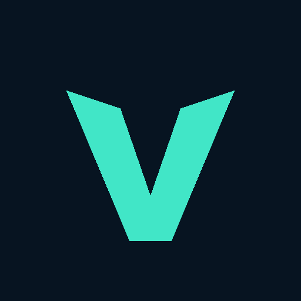

<div align="center">

# VELDIGO
### Your crypto. Your control.

**A modern Android crypto wallet built for self-custody, transparent transactions and a clean, focused experience.**



[Android](https://github.com/bren-wp/Veldigo-Wallet) · [Source code](https://github.com/bren-wp/Veldigo-Wallet/tree/main) · [Releases](https://github.com/bren-wp/Veldigo-Wallet/releases) · [Security & release status](docs/SECURITY_RELEASE_GATES.md)

</div>

---

## Take control of your crypto

Veldigo combines a distinctive dark-navy design with mint accents and an open-source, multi-chain wallet foundation. Create your own wallet, import one you already control, and explore crypto assets from a single Android app.

### Self-custody, designed with intention

**See your portfolio clearly.** View assets, real wallet balances and chain-specific activity with a minimalist dashboard.

**Send with confidence.** Enter the correct address and inspect the amount, asset, network and fee through the existing confirmation process.

**Receive securely.** Generate a live receiving address and QR code for the selected chain. Never substitute illustrative reference addresses.

**Stay in control.** Create or restore a wallet, configure PIN/biometric protection where available, and review local wallet security controls.

### Essentials, designed with intent

- **See more, with less noise.** A midnight-blue portfolio with actual wallet balances and mint-accented actions.
- **Send deliberately.** Review destination, network, asset and transaction fees in the existing confirmation flow.
- **Receive confidently.** Share or copy the *real receiving URI* and scan a high-contrast QR without a logo obscuring its code.
- **Recover responsibly.** Securely back up recovery words offline. Never send seed phrases to support agents or websites.
- **Manage access.** Set local device protection, review security settings and keep recovery phrases offline.

### Designed around what matters

| Experience | What you can do |
|---|---|
| **Your wallet, your keys** | Create or import a non-custodial wallet. Keep a recovery phrase offline and never share it. |
| **One portfolio** | View supported assets, live wallet balances, network details and transaction history. Availability varies by chain and provider. |
| **Send with clarity** | Enter an address, review the amount, selected network and network fee, then confirm through the wallet's transaction flow. |
| **Receive with confidence** | Display and share the receiving address and an actual QR code for the selected asset/network. |
| **Explore supported networks** | The underlying wallet provides multiple blockchain adapters, including Bitcoin, EVM-compatible networks and other integrated networks. |
| **Security controls** | PIN/biometric entry and local wallet recovery flows are inherited from the upstream foundation and require independent review before production distribution. |

### The Veldigo aesthetic

- **Night navy:** `#071421`
- **Card surface:** `#112337`
- **Mint:** `#41E6C7`
- **Secondary text:** `#B5C6D7`
- Rounded action tiles, clearly separated assets, restrained hierarchy and accessible targets
- Optimized for dark mode; the visual design is being implemented against the reference mockups

### Your essential actions, in one place

**Create** a wallet and back up its recovery phrase. **Import** an existing wallet using the supported secure recovery flow. **Receive** through a chain-specific address and QR code. **Send** only after inspecting the recipient, amount and fee. **Monitor** actual wallet balances and history.

### Veldigo isn't an exchange

Veldigo is strictly a non-custodial wallet for managing, receiving and sending owned crypto assets. Buying, selling, swapping, trading, staking, NFTs, dApp browsing and WalletConnect are **outside the product scope**. The legacy codebase is being audited to isolate and decommission those subsystems without disrupting core blockchain signing, fee estimation or synchronization.

## Android UI/UX

Veldigo uses a wallet-only navigation model: **Wallet · Assets · Activity · Settings**, with real **Send** and **Receive** actions. Its dark navy + mint direction covers the portfolio, settings, wallet creation and transaction flows. Supported device sizes, Android font scaling, visual states and accessibility must be checked before a real-money launch.

Every token icon, amount, fee, receiving address and transaction history entry must reflect the **real wallet state**. Illustration values from design concepts are never authentic blockchain data.

## Veldigo Android 0.4 engineering preview

Built for Android in **Kotlin and Jetpack Compose**, Veldigo retains a non-custodial architecture inherited from its MIT-licensed upstream project. Our design system prioritizes readable typography, thoughtful spacing, accessible controls, subtle outlines, and a recognisable **#41E6C7** mint accent.

The merged wallet-only PR #7 removes new Buy, Markets, Swap and NFT UI, excludes trading charts from asset details, restricts external deep links to chain-native payment requests and keeps the real send/receive infrastructure. A follow-up adds PIN gating for Assets/Activity shortcuts and removes main-screen donation/rating prompts. The upstream legacy modules still require a dependency and session-migration audit. All existing blockchain operations continue to require per-network verification and approved service keys. See [the pixel-parity checklist](docs/REFERENCE_1TO1.md) and [production blockers](docs/SECURITY_RELEASE_GATES.md).

## Downloads and current status

The [Releases page](https://github.com/bren-wp/Veldigo-Wallet/releases) provides **v0.4.0-preview.2** test-only APK/AAB artifacts with SHA-256 checksums and source revision. These are **not production-signed** and must not hold real funds. Preview APK/AAB artifacts may use **test signing** and are **not intended for real funds**.

**Production readiness is pending.** A successful Android compilation does not establish that a financial application is safe. Before publishing as a wallet for real assets, independent security review, transaction validation by chain, real-device QA, provider credential replacement, release signing, and regulatory/platform checks are required. See [release gates](docs/SECURITY_RELEASE_GATES.md) and the [October 31 security-audit progress and blockers](docs/SECURITY_AUDIT_PROGRESS_2026-10-31.md).

## Wallet safety

Cryptocurrency transactions are generally irreversible. Always inspect the recipient and network, protect recovery words offline and do not share a seed phrase with anyone claiming to provide Veldigo support. Veldigo is not a custodian or an exchange, and swaps and purchases are not supported product features.

## Open source & attribution

Veldigo is developed under the **Brendigo** brand. Its wallet foundation is a modified derivative of [Unstoppable Wallet Android](https://github.com/horizontalsystems/unstoppable-wallet-android), sourced from pinned upstream commit `d6661c8d0dc02d259767f58b7cd73cabb877da18` under MIT terms. The original authors retain their rights; Veldigo is independent and **not endorsed by Horizontal Systems**.

Review [the root license](LICENSE), [upstream MIT license](licenses/Unstoppable-Wallet-MIT.txt) and [third-party notices](THIRD_PARTY_NOTICES.md). Blockchain token symbols, external provider names and other trademarks are the property of their respective owners.

## Development and verification

Built with **Kotlin / Jetpack Compose**. Package name: `com.brendigo.veldigo`. Minimum Android version follows upstream (API 28 at the pinned revision).

```bash
./gradlew :app:assembleBaseDebug
./gradlew :app:bundleBaseDebug
```

For reproducible provenance, refer to the pinned import commit in [the import script](scripts/import_upstream.py). Use [the screen parity matrix](docs/REFERENCE_1TO1.md) when reviewing every Android screen. For a production build, configure project-owned credentials and secure signing through CI secrets; never commit release keys, mnemonics or private keys. See [wallet-only migration status](docs/WALLET_SCOPE_DECOMMISSION_2026-10-30.md), [chain verification matrix](docs/CHAIN_SUPPORT_MATRIX.md) and [Transaction History QA](docs/TRANSACTION_HISTORY_SCREEN_QA_2026-10-30.md).

---

<div align="center"><strong>VELDIGO</strong> · Built with purpose by <strong>Brendigo</strong></div>
